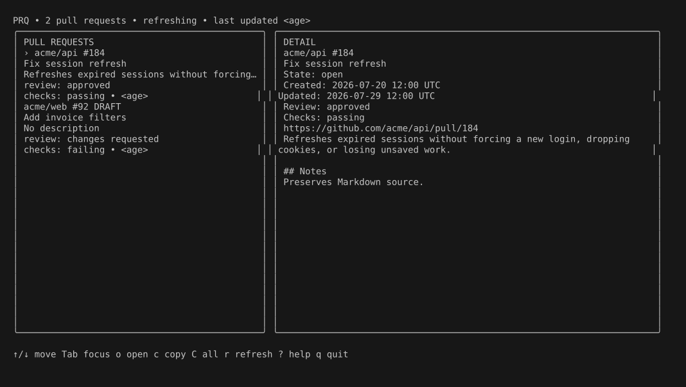
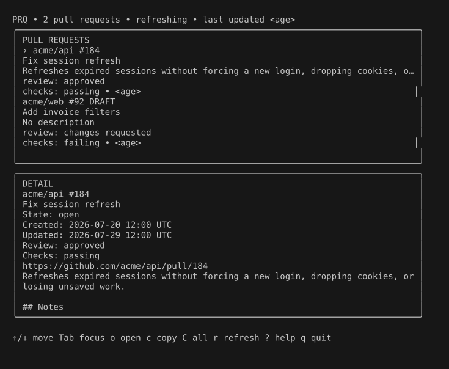

# PRQ

PRQ is a keyboard-first terminal dashboard for the open pull requests you
authored across a selected set of GitHub repositories.

## What PRQ does

PRQ restores pull request context without making you keep a browser dashboard
open. It shows open pull requests authored by the current GitHub user, including
drafts, with their descriptions, review decisions, check states, and update
times. A persistent detail pane shows the full body of the selected pull
request.

The dashboard displays cached results immediately, refreshes from GitHub in the
background, and keeps usable cached data visible if a refresh fails.



At terminal widths below 100 columns, the list moves above the detail pane:



## Status: macOS-only v1

PRQ v1 supports macOS. It uses the macOS `pbcopy` and `open` commands for
clipboard and browser actions.

Version 1 does not include:

- GitHub mutations such as comments, reviews, labels, assignments, state
  changes, merges, or edits
- Slack API or webhook integration
- Reminder tracking or scheduled notifications
- AI-generated summaries
- A public JSON interface or general-purpose `list`, `copy`, or `open`
  subcommands
- A native menu-bar or SwiftUI application
- Linux or Windows support
- GitHub Enterprise Server support
- Dashboard search or filtering
- Automatic local-repository discovery
- Multiple organizations in one configuration
- Recently merged or closed pull requests
- Reviewer-specific status
- Rich Markdown rendering of pull request descriptions
- Homebrew distribution

## Prerequisites: Go 1.26 and authenticated gh

You need:

- macOS
- Go 1.26
- [GitHub CLI](https://cli.github.com/) available as `gh`
- An authenticated GitHub CLI session with access to the organization and
  repositories you want to view

Check authentication with:

```bash
gh auth status --hostname github.com
```

If needed, authenticate before starting PRQ:

```bash
gh auth login
```

## Install: go install github.com/kenyounot123/prq/cmd/prq@latest

```bash
go install github.com/kenyounot123/prq/cmd/prq@latest
```

Ensure the Go binary directory is on your `PATH`, then confirm the installation:

```bash
prq --version
```

## First run

Run:

```bash
prq
```

When no valid configuration exists, PRQ starts setup automatically. Choose one
GitHub organization, then select one or more repositories. After the prompts
succeed, PRQ atomically commits the selection and opens the dashboard. Cleanup
of an older cache is best effort: every cache is bound to the normalized
selection that produced it, so PRQ ignores a leftover cache rather than showing
pull requests from a different configuration.

Run `prq setup` whenever you want to replace the organization and repository
selection. The available command surface is:

```text
prq
prq setup
prq --help
prq --version
```

PRQ does not run `gh auth login` for you.

## Keyboard controls

| Key | Action |
| --- | --- |
| `↑` / `↓` | Move the selected pull request when the list is focused; scroll the body when the detail pane is focused |
| `Tab` | Move focus between the list and detail pane |
| `o` | Open the selected pull request in the default browser |
| `c` | Copy the selected pull request URL |
| `C` | Copy all displayed pull requests as Slack-formatted bullets |
| `r` | Refresh from GitHub |
| `?` | Toggle full key help |
| `q` | Quit |

The open, copy, bulk-copy, refresh, help, and quit keys work regardless of which
pane is focused. `Enter` has no dashboard action in v1.

Bulk copy follows dashboard order and produces one line per pull request:

```text
• <https://github.com/acme/api/pull/184|Fix session refresh> — Refreshes expired sessions without forcing a new login.
```

The full title becomes the Slack link label, and the full compact description
follows it. PRQ escapes Slack-sensitive `&`, `<`, and `>` characters in titles
and descriptions. Pull requests without a meaningful body use
`No description`.

## Data and privacy

PRQ stores two private, versioned JSON files:

- Configuration: `~/Library/Application Support/prq/config.json`
- Cache: `~/Library/Caches/prq/pull-requests.json`

The paths are derived from Go's platform directory APIs. Configuration contains
the selected organization and repository allowlist. The cache contains the last
successful normalized pull request result and its fetch time. Neither file
contains a GitHub token. Writes use a temporary file and atomic rename, with
user-only permissions where the platform supports them.

PRQ also writes copied text to the system clipboard. Opening a pull request
delegates its validated `https://github.com` URL to the macOS browser.

## Read-only GitHub guarantee

PRQ shells out to your authenticated `gh`; it does not read, persist, or log
GitHub tokens. The GitHub boundary exposes only authentication status and fixed,
named GraphQL `query` documents. User-controlled values are passed as GraphQL
variables, never inserted into operation text.

Every `gh` invocation is checked against an allowlist. The runner accepts only
`gh auth status` and the fixed PRQ GraphQL queries, and refuses mutation
operations, unrecognized documents, flags, or variables. Tests enumerate the
queries and inspect subprocess arguments to preserve this invariant. GraphQL
uses HTTP POST as transport, but every operation is a read-only `query`.

PRQ writes only to its local configuration, local cache, and the system
clipboard. Opening a URL is a local browser action, not a GitHub API write.

## Development

The complete test suite uses fixtures and fake `gh`, `pbcopy`, and `open`
executables. It requires no GitHub credentials and performs no external writes.

```bash
go mod download
gofmt -w .
go vet ./...
go test ./...
go build ./cmd/prq
```

CI runs formatting, vet, race-enabled tests, and a build on macOS.

## Contributing

Contributions are welcome. Read [CONTRIBUTING.md](CONTRIBUTING.md) for the local
workflow and review expectations. By participating, you agree to follow the
[Code of Conduct](CODE_OF_CONDUCT.md). Please report security concerns according
to [SECURITY.md](SECURITY.md).

## License

PRQ is available under the [MIT License](LICENSE).
